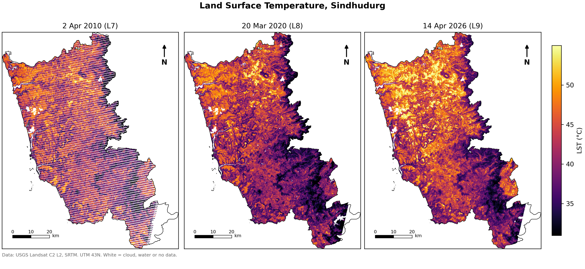
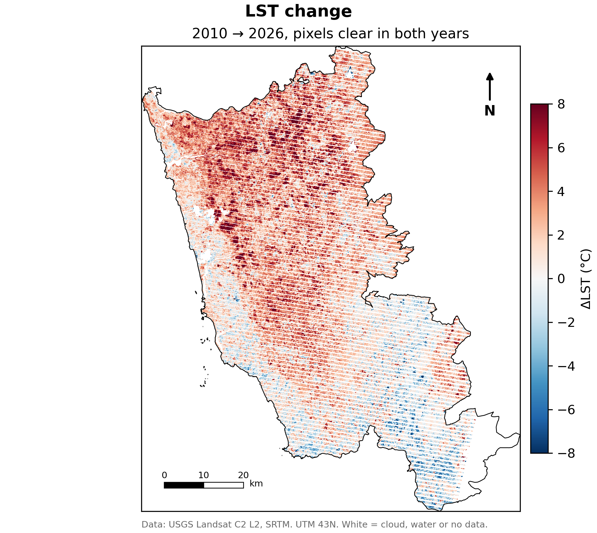
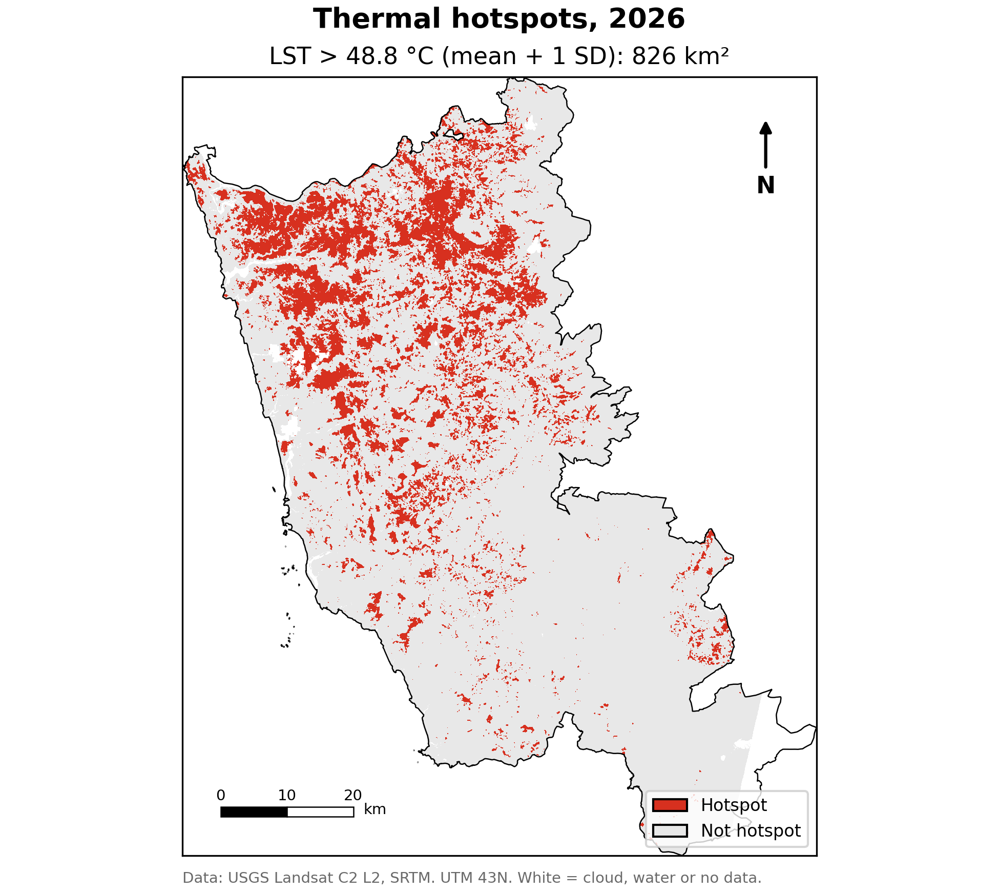

# Surface Urban Heat in Sindhudurg District, Maharashtra (2010 – 2026)

Land Surface Temperature (LST), NDVI and NDBI from Landsat, change detection, and a Random Forest model of what controls surface heat. Built as a fully reproducible Python workflow run inside ArcGIS Pro.

**Study area:** Sindhudurg District, Konkan coast, Maharashtra (≈ 5,100 km², 8 talukas)
**Data:** USGS Landsat Collection-2 Level-2 (Landsat 7, 8, 9), SRTM 1-arcsecond DEM
**Tools:** Python (rasterio, geopandas, numpy, scikit-learn, matplotlib) in ArcGIS Pro 3.6



## Key findings

| Result | Value |
|---|---|
| Mean LST change, 2010 → 2026 (pixels clear in both years) | **+2.08 °C** |
| Seasonal check: 14 Apr vs 22 Apr 2026 (same year, 8 days apart) | +0.08 °C, so the scene-date gap does not explain the warming |
| Mean NDVI 2010 / 2020 / 2026 | 0.442 / 0.539 / 0.541 (greening to 2020, then a plateau) |
| Mean NDBI change, 2010 → 2026 | −0.064 |
| Random Forest (LST ~ NDVI + NDBI + DEM), held-out test | **R² = 0.72, RMSE = 2.99 °C** |
| Predictor importance (impurity) | NDBI 68.6 %, NDVI 19.9 %, DEM 11.5 % |
| Thermal hotspots 2026 (LST > mean + 1 SD = 48.8 °C) | **826 km²**, 16.6 % of clear land |

Warming is concentrated in the **north-western coastal belt and northern talukas**. Parts of the south-east (Dodamarg side) cooled.
NDVI rose overall, but much of this greening reflects the expansion of commercial plantations (mango, cashew), not natural forest recovery. At 30 m, NDVI measures greenness, not forest type.

| | |
|---|---|
|  |  |

## Data

| Epoch | Scene | Date | Notes |
|---|---|---|---|
| 2010 | Landsat 7 ETM+, L2SP, path/row 147/049 | 2 Apr 2010 | SLC-off scan-line gaps: 72.7 % of the district usable |
| 2020 | Landsat 8 OLI/TIRS, L2SP, 147/049 | 20 Mar 2020 | Earliest in season; shown for context, not used in the trend |
| 2026 | Landsat 9 OLI-2/TIRS-2, L2SP, 147/049 | 14 Apr 2026 | |
| 2026 (check) | Landsat 8, L2SP, 147/049 | 22 Apr 2026 | Used only for the seasonal check |
| DEM | SRTM 1-arcsecond (4 tiles) | — | |

The raw imagery is not included because it is too large for GitHub. It is free from [USGS EarthExplorer](https://earthexplorer.usgs.gov/) using the scene dates above.

## Method

1. **Common grid.** 30 m UTM 43N, snapped to the Landsat pixel grid and clipped to the district boundary.
2. **Scaling.** Collection-2 Level-2 scale factors: reflectance = DN × 0.0000275 − 0.2; surface temperature = DN × 0.00341802 + 149 − 273.15 (°C).
3. **Masking.** The QA_PIXEL band removes fill, cloud, dilated cloud, cirrus, cloud shadow and water.
4. **Indices.** NDVI = (NIR − Red) / (NIR + Red); NDBI = (SWIR1 − NIR) / (SWIR1 + NIR).
5. **Change detection.** The mean of the difference image over pixels clear in **both** years, so Landsat 7 gaps don't bias the result.
6. **Random Forest.** 200 trees, 30,000 sampled pixels, **spatially blocked** test split (5 km blocks, 25 % held out) to avoid optimistic scores from neighbouring pixels. Reports test R²/RMSE, impurity importance and permutation importance.
7. **Hotspots.** LST above mean + 1 SD of clear land pixels, 2026.

## Limitations

- NDVI and NDBI are strongly correlated (r = −0.92), so the split of importance between them is not unique.
- NDBI responds to bare and dry soil as well as built-up land, especially in the pre-monsoon season.
- There is one scene per epoch, so interannual weather is not averaged out. The seasonal check covers mid-to-late April only.
- The Landsat 7 2010 scene has scan-line gaps (visible as diagonal stripes in the 2010 maps).
- At 30 m, the analysis cannot separate natural forest from plantations, or resolve small coastal clearings.
- 2000 (Landsat 5, Level-1 only) is excluded: its temperature can't be compared with the Level-2 products.

## Repository

```
notebooks/Sindhudurg_UHI_Python.ipynb   full workflow, Steps 0–12, with outputs
figures/                                 final maps (PNG)
docs/arcgis_vs_python.md                 how this version corrects the earlier ArcGIS analysis
environment.yml                          Python packages
```

## How to run

1. In ArcGIS Pro: Package Manager → clone `arcgispro-py3` → activate it → add **rasterio** and **geopandas**. Or use any Python 3.11+ environment with `environment.yml`.
2. Download the scenes listed above.
3. Open the notebook, edit the paths in **Step 1**, and run the steps in order. Step 11 (adding layers to a map) needs ArcGIS Pro; everything else is plain Python.

## Author

Chaitanya Bandekar. Independent project, 2026.
